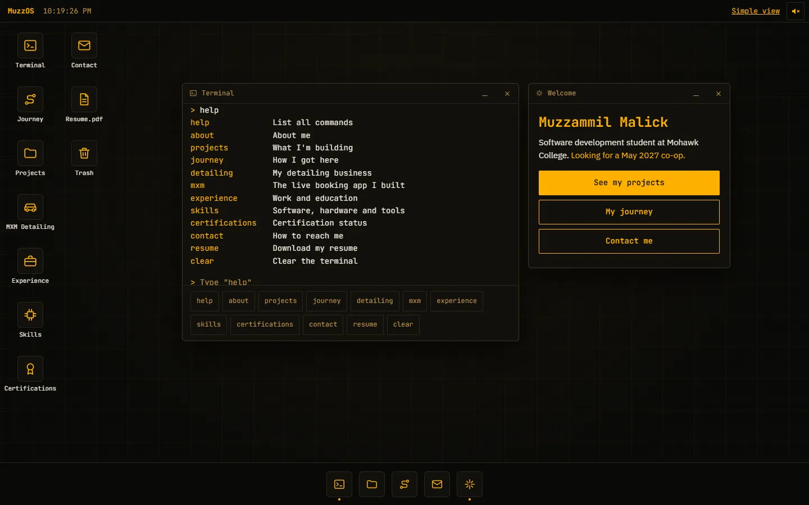
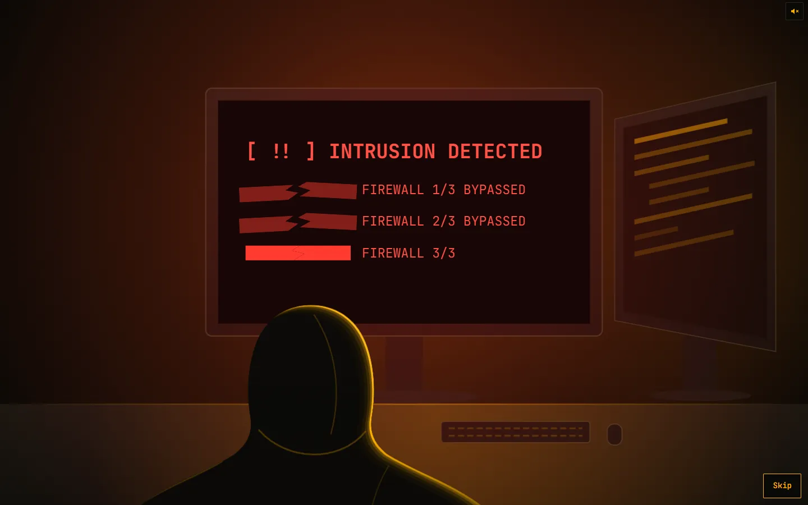
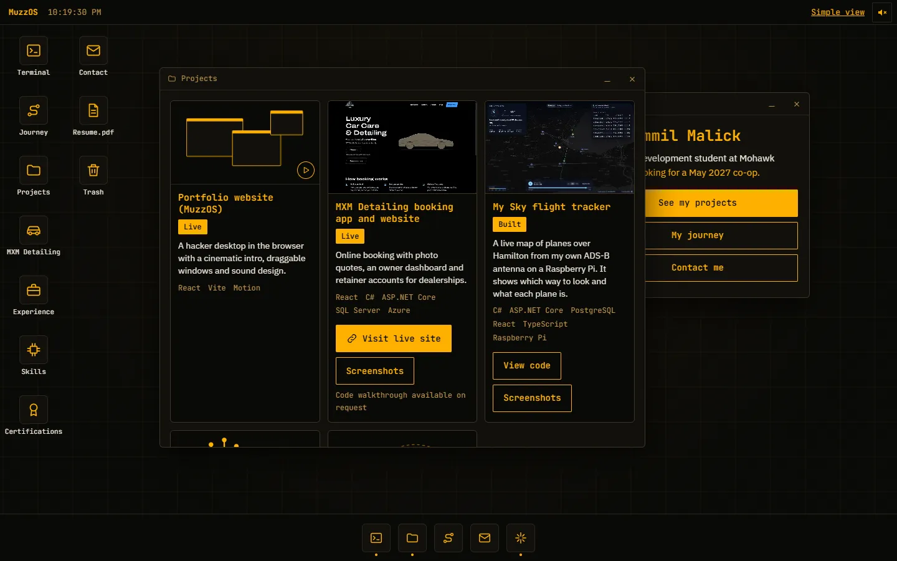
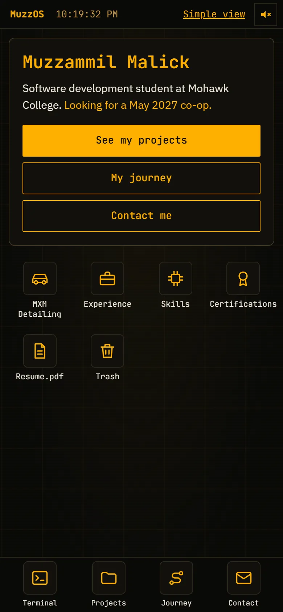
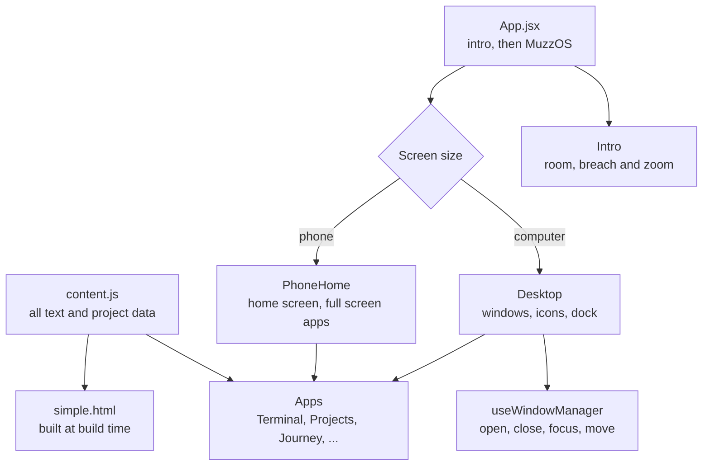

# MuzzOS: my portfolio

My portfolio, built as a small operating system in the browser. It opens with a short animated intro, then lands on a desktop with draggable windows, a terminal you can type in and an app for each part of my story. On a phone it turns into a home screen instead.

Live at **https://muzzammilamirmalick.github.io**. There is also a [Simple view](https://muzzammilamirmalick.github.io/simple.html), a plain one-page version for a quick read.



| The intro | Projects | Phone |
| --- | --- | --- |
|  |  |  |

## Features

- **Intro**: a hand-drawn SVG room that zooms into the monitor and lands exactly on the real Terminal window. It can be skipped, and it is replaced by a simple fade for people who turn on reduced motion.
- **Desktop**: windows open from their icon, can be dragged, minimized to the dock and closed with Esc. They stay on screen when the browser is resized.
- **Terminal**: commands with history (Up and Down), Tab autocomplete and buttons for phone users. Try `help`.
- **Phone layout**: apps open full screen and the phone's back button closes them.
- **Sound**: every effect is made in code with the Web Audio API, so there are no audio files. There is a mute button.
- **Simple view**: built from the same content file at build time, so it needs no JavaScript.
- **Accessibility**: keyboard support everywhere, focus goes back where it came from when a window closes, and screen readers get the final text instead of the animations.

## Tech stack

- React 19 and Vite
- Motion for the animations
- Sonner for the small toast messages
- Vitest for tests
- GitHub Actions and GitHub Pages for deploys

## How it fits together



- `src/data/content.js` holds all of the site's text, so changing the content never means touching a component.
- `src/os/` is the "operating system": the desktop, the phone home screen, windows and the window manager.
- `src/apps/` has one component per app. Most are loaded only when they are first opened.
- `src/components/intro/` is the intro. `introTimeline.js` has every timing in one place, and `sceneLayout.js` has the camera maths.
- `src/simple/renderSimplePage.js` turns `content.js` into plain HTML for Simple view during the build.

## Running it

You need Node.js 22.12 or newer.

```bash
npm install
npm run dev      # start a local server with hot reload
npm test         # run the tests
npm run build    # build the site into dist/
npm run preview  # serve the built site
```

Every push to `main` runs the tests, builds the site and publishes it to GitHub Pages.

The before and after detailing photos are made from the originals in `photos/detailing/` with `python scripts/detailing-photos.py` (needs Pillow).
